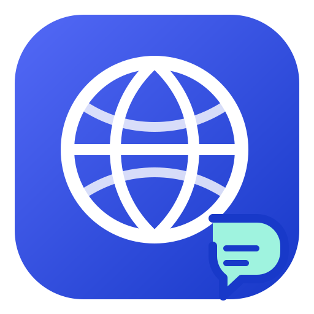

  

<h1 align="center">Lightweight Translation</h1>

<strong>🌍 Translate freely. Stay lightweight. Pay nothing.</strong> 
Make your WordPress site multilingual, without making it feel complicated. ✨

I built Lightweight Translation because I wanted a simpler way to translate my own WordPress site. I wanted to choose my languages, keep control of my content, and avoid a complicated workflow just to make a site multilingual. So I started building the plugin I wished I had—and decided to share it. ❤️

The idea is simple: keep your original pages, products and other content in WordPress, and manage translations alongside them. Visitors see the language they choose at an address such as `/fr/`. The plugin does not send page views to an external translation service, and you can translate the texts yourself or use the tools you already trust. 🌐

Lightweight Translation is still growing. It is built with a small, modular core and optional integrations, with the goal of making multilingual WordPress easier to understand and maintain. If you find a bug or have an idea, your feedback can help make it better. 🛠️

## 🚀 Get started

Install the plugin ZIP from **Plugins → Add New**, then open **Translations → Settings**. Choose your site's original language and add the languages you want to offer. You can start translating right away; the included WooCommerce catalog also makes common shop texts available before you run a site scan.

## 🧭 Find your way around

- 📊 **Overview** gives you a quick picture of translation progress and points you to the next step.
- ✍️ **Translate** keeps work organized by source: **Pages & posts**, **Menus**, **WooCommerce**, **Theme**, **Plugins** and **Other content**. WooCommerce appears when it is active. Within WooCommerce and Theme, a left-hand list helps you go straight to the right kind of content, such as products, shop texts, settings or widgets.
- 🔎 **Check the site** visits public pages in the languages you choose, looks for visible text that still needs translation, and lets you open the relevant translation from a result.
- 📦 **Import / Export** lets you move translations in bulk. Export a CSV, translate it yourself or with an external AI tool, then import it again. The plugin includes a prompt to help with that workflow, but does not call an AI provider or require an API key. You can also download and restore a full JSON backup.
- ⚙️ **Settings** is where you manage languages, the language selector and maintenance. Add the selector to a WordPress menu, place it in a block with `[lt_language_switcher]`, or show a bulleted language list with `[lt_language_switcher style="list"]`—handy for a footer.

## 🧩 Integrations

The translation core works with WordPress on its own. Optional support for WooCommerce, WoodMart and WooCommerce Product Bundles is loaded only when the corresponding integration is available. Gutenberg content is supported, and scanning can find additional texts specific to your site and setup. When another extension reuses a WooCommerce or theme text, its translation can be shared rather than duplicated.

## 🧹 Your content stays yours

Translations are stored separately from your original WordPress content. If you decide to remove the plugin, its uninstall routine removes the translation data it owns; your pages, products and other WordPress content remain. Download a full JSON backup first if you may want to restore your translations later.

The admin interface follows the WordPress user's language, with French included. This project is a work in progress, and compatibility can vary across sites and extensions. Bug reports, ideas and pull requests are very welcome—especially when they help make the plugin simpler for the next person. 🙌

<strong>Less hassle. More languages. More freedom. 🌍</strong> 
Made out of frustration. Shared with everyone. Built to stay lightweight.

